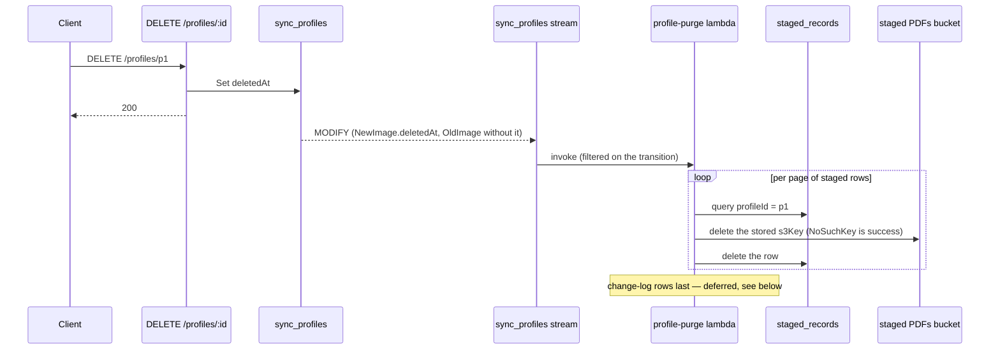

# Profile deletion

`DELETE /profiles/:id` removes a profile from service immediately and cleans up its stored data
afterwards. Nothing the user holds in their vault is deleted by this path.

## The delete is soft

The request writes one attribute and returns:

1. `deletedAt` (ISO timestamp) is set on the profile row.
2. The handler answers `200`. A repeated `DELETE` answers `200` again and writes nothing.
3. No event is written by the handler. The row change is the intent, and DynamoDB Streams
   delivers it at least once.

The row is retained for audit. There is no undelete path through the API.

## Readers exclude a deleted profile in one place

`packages/core/src/sync-profile-db.ts` owns the filter. `readProfileRow` reads the row,
`getProfile` returns `null` for a soft-deleted row and `listProfiles` drops soft-deleted rows.
Every reader composes those two functions, so no caller can forget:

| Reader                                    | Path                                                                                 |
| ----------------------------------------- | ------------------------------------------------------------------------------------ |
| `GET /profiles`                           | `listProfiles`                                                                       |
| `GET`/`PUT /profiles/:id`                 | `getProfile` → `404`                                                                 |
| `DELETE /profiles/:id`                    | `readProfileRow` → `200` when already deleted                                        |
| `GET /files/changes` active-profile scope | `listProfiles`                                                                       |
| `GET /files` (delivery feed)              | `listProfiles`                                                                       |
| `POST /sync/run` active-profile scope     | `listProfiles`                                                                       |
| `GET /status`                             | raw row + `isProfileDeleted`, because it reads the out-of-schema `oneDriveConnected` |
| profile creation's `isFirst` check        | `listProfiles`, so a deleted profile cannot suppress `active: true` on the next one  |
| the ingest walk's profile list            | `listProfiles`                                                                       |

## Unreachability comes before cleanup

`deletedAt` removes the profile from `listProfiles` and from `getProfile`, so the profile is out of
every list, out of the feed's active-profile scope and out of every stored-key read path. Cleanup is
therefore a storage-hygiene job. It is never a correctness race: no reader can be serving a key the
janitor is about to delete.

## The janitor owns the cleanup

The janitor lives in the staging domain (`packages/staging-consumer`) because it deletes staged
rows and staged objects. The profile domain never learns what S3 is.

Ownership of what the delete touches:

| Resource                   | Owner of the purge          | Today                                                                                                     |
| -------------------------- | --------------------------- | --------------------------------------------------------------------------------------------------------- |
| profile row                | nobody — retained for audit | set `deletedAt`, never hard-deleted                                                                       |
| `staged_records` rows      | profile-purge lambda        | deleted                                                                                                   |
| staged S3 objects          | profile-purge lambda        | deleted                                                                                                   |
| change-log rows            | profile-purge lambda        | deferred: `petroglyph-xgyd` owns the table and is not on `main`                                           |
| legacy `file_records` rows | the API handler, as before  | deleted in the request                                                                                    |
| Graph subscription         | the reconciler              | no reconciler on `main`; the profile drops out of `listProfiles` so a future reconciler stops renewing it |

## Order inside a page

Read the page, delete the objects it names, then delete the rows. Rows go last because the rows are
the work list: a crash between the two steps leaves the rows in place and the replay re-derives the
same keys. Deleting a row first would strand an object with nothing left to name it.

The delete uses the stored `s3Key`, as every other reader does. Before deleting, the janitor checks
that the key sits under `deriveStagingPrefix({profileId})` — the single prefix function in
`packages/staging-contracts/src/keys.ts`. A key that does not match is logged and its object is left
alone, so a corrupt row can never delete another profile's object. The row is deleted anyway: it is
unreachable garbage, and the layout version is part of the key, so a version bump alone puts every
older row in that state. Keeping the row would stop the pass from ever reaching zero.

## At least once, and idempotent

DynamoDB Streams delivers the row change at least once. A redelivery re-runs the same keyed deletes:

- deleting an already-missing object succeeds (`NoSuchKey` is treated as success),
- deleting an already-missing row succeeds,
- an empty page is success.

No marker and no job table exist, so no state can drift from the storage it describes.

The event source mapping filters on the transition (`NewImage.deletedAt` present and
`OldImage.deletedAt` absent), so a rename, an edit or a later replay of an already-clean profile
does not start a purge. The handler repeats the check, so it is correct without the filter.

## Bounded work and the handoff

One invocation deletes at most `PURGE_OBJECT_BUDGET` objects (`PURGE_PAGE_SIZE` per page). When the
budget runs out the invocation reports the stream record as a batch item failure. Streams redelivers
the record, the purge starts again from the first remaining row, and the loop continues until a pass
finds nothing. Both paths — complete in one pass, or handed off — reach zero.

A 24-hour stream retention bound is a **latency** bound, not a loss bound for a profile deleted while
the janitor is healthy. A record that ages out mid-purge leaves rows behind, and no scheduler on
`main` sweeps them yet; see _Not implemented here_.

## Access

The janitor's IAM policy names these actions and nothing wider:

| Action                                                                                                | Resource                                                                |
| ----------------------------------------------------------------------------------------------------- | ----------------------------------------------------------------------- |
| `dynamodb:DescribeStream`, `dynamodb:GetRecords`, `dynamodb:GetShardIterator`, `dynamodb:ListStreams` | the `sync_profiles` stream                                              |
| `dynamodb:Query`, `dynamodb:DeleteItem`                                                               | the `staged_records` table                                              |
| `s3:DeleteObject`                                                                                     | `<staged bucket>/staging/*`                                             |
| `s3:ListBucket`                                                                                       | the staged bucket, conditioned on `s3:prefix` = `staging/`, `staging/*` |
| `logs:CreateLogStream`, `logs:PutLogEvents`                                                           | the function's log group                                                |

Every object action is scoped to the layout root `staging/`, not to a version: the version segment
lives inside that root, so a layout bump (`v1` to `v2`) neither widens nor breaks the grant.

## Limits

- Soft delete is irreversible through the API. There is no undelete.
- `DELETE` is idempotent and answers `200` on the second call. A hard `404` would make a retry look
  like a failure.
- Nothing in the user's vault is ever deleted by this path. The staged records and the staged S3
  objects are Petroglyph's, and the vault copy belongs to the user.
- The legacy `file_records` cascade still runs inside the request. It predates this model and is
  recorded here so its removal is a deliberate change, not a surprise.

## Not implemented here

- **Change-log rows.** `petroglyph-xgyd` introduces the change log and its `seq` cursor; that table
  is not on `main`. The janitor purges staged rows and objects only, and the change-log delete is the
  remaining step in the same handler, ordered after the staged rows.
- **Orphan GC.** A bounded pass over staged rows whose `profileId` has no live profile needs the
  hourly reconciler. No reconciler exists on `main`, so historical orphans stay until that lands.
