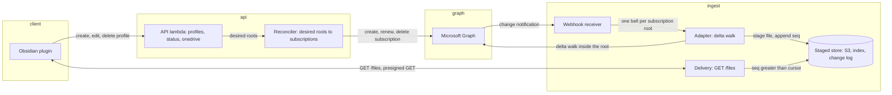
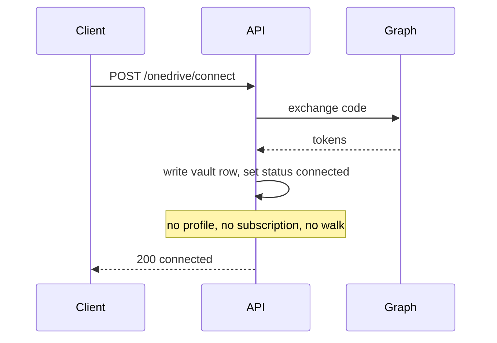
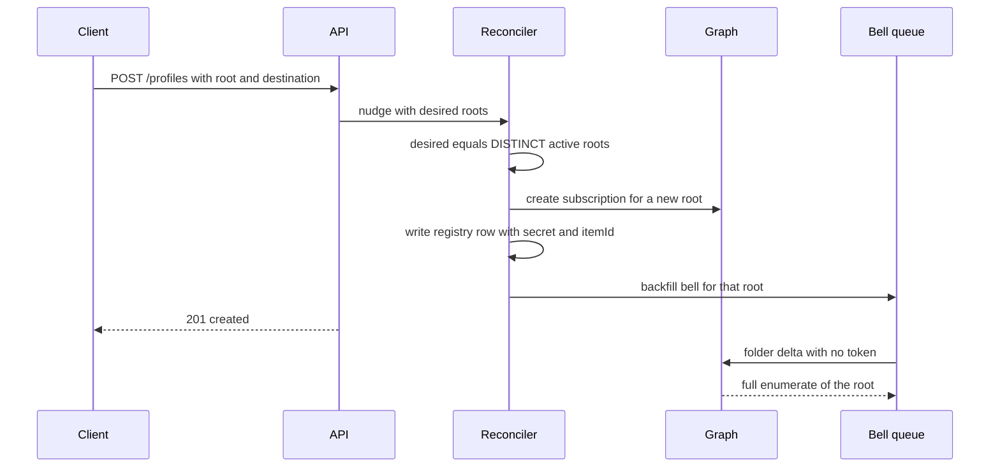
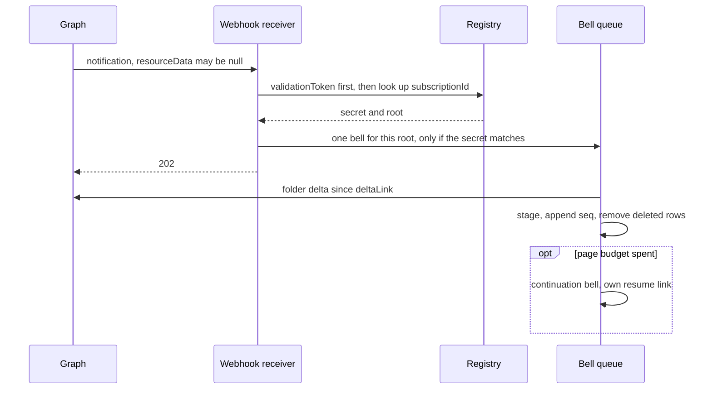
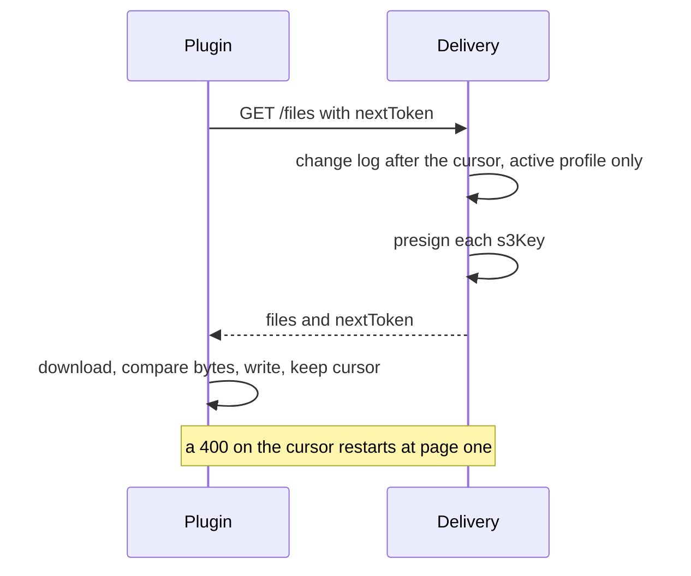
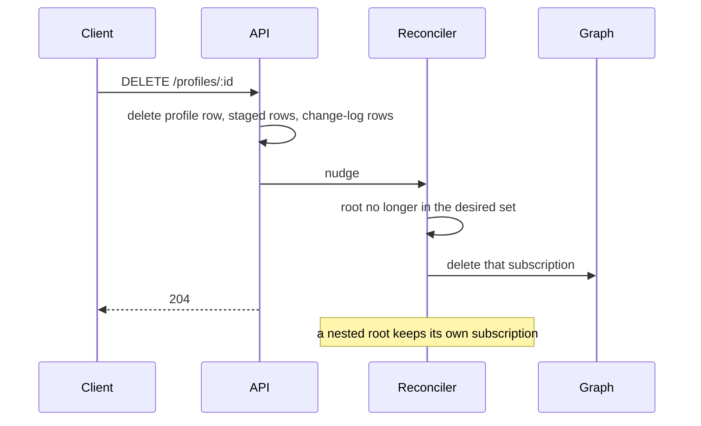
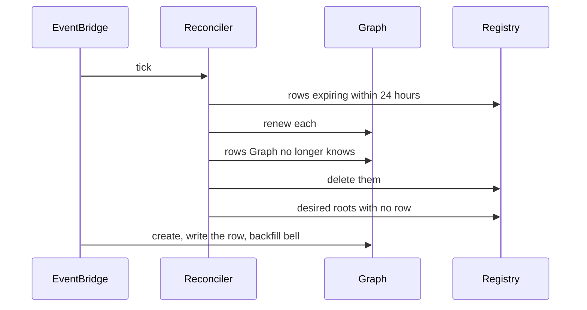
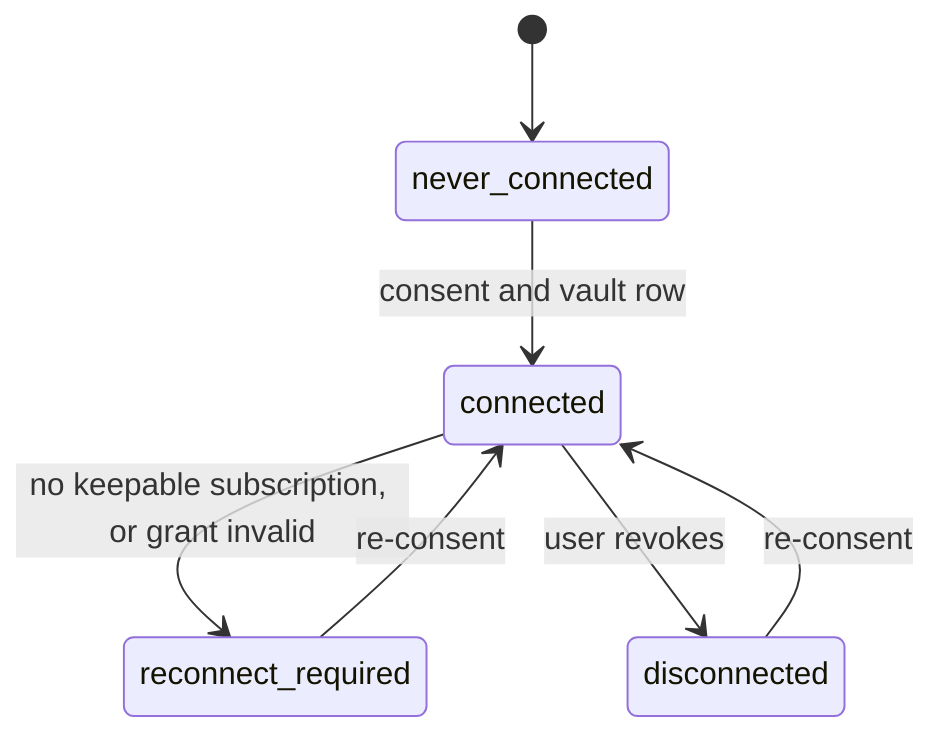
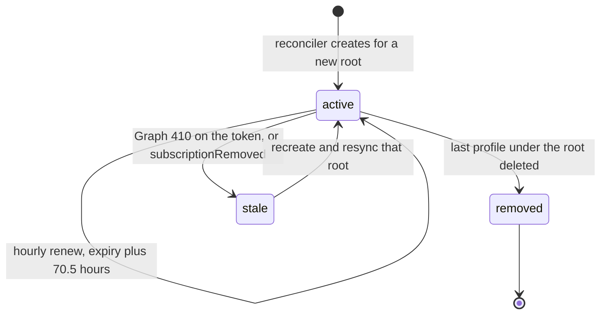

# Sync lifecycle

How a file travels from OneDrive into an Obsidian vault, and what may never be true while it does.
This is the reference a reviewer cites. Where the code does not yet match the design, the section
carries a `(not yet implemented: <bead>)` marker and a **Today** paragraph naming the code that runs.

The settled design is Option 1 (decided 2026-11-15): a profile owns its staged content, and one
subscription exists per distinct active profile root. Three seams keep Option 2 reachable — the
reconciler takes `DesiredRoot[] = { root, ownerProfileId }` and never reads a profile row; staged rows
carry `profileId` and `subscriptionId` through one prefix function; Graph state lives only in the
subscription registry.

## Domains

Four facts, four owners. Nothing else may write them:

| Fact                                         | Owner                                               | Never written by      |
| -------------------------------------------- | --------------------------------------------------- | --------------------- |
| Tokens, connection status                    | connection (`users`, `token_vaults`)                | profiles, ingest      |
| Which roots are worth watching               | profile rows                                        | subscriptions, ingest |
| Graph subscription, folder itemId, deltaLink | subscription registry (not yet implemented: y5bm.2) | profiles, client      |
| Staged content and its change order          | staging (`seq`; not yet implemented: xgyd)          | client, Graph         |

Today the fourth row's order is the `staged_records` key order on `itemId`, not a `seq`, and the
third row's `deltaLink` lives per connection in `delta_states`.
`registerGraphSubscription` discards the `subscriptionId` it receives, so no subscription is stored.

## 1. Connect authorises; nothing else

**Today** this is the target, not the code. `onedrive-connect.ts:269-271` also calls
`registerGraphSubscription` — a drive-root subscription with `clientState = userId`, whose id is then
dropped — and `upsertSyncProfile`, which upserts a `default` profile with `sourceFolderPath: "/"` and
`destinationVaultPath: "handwritten"`. Bead `petroglyph-bw3p` removes both and is **paused**.

## 2. Create a profile — reconcile, subscribe, backfill

**Today** (not yet implemented: bw3p, y5bm.2, z23z) there is no reconciler, no subscription registry
and no backfill bell. `profiles.ts:24-46` writes the profile row and returns 201; the first profile
becomes `active`, later ones do not. A subscription is created only by connect, for the drive root, so
the first walk is whatever the next bell triggers.

## 3. A change arrives in OneDrive

**Today** the receiver is inert for this path (`ingest-onedrive/src/index.ts:217-249`): it echoes
`validationToken` but otherwise requires a non-null `resourceData`, answering `400` when Graph sends
none; it checks `clientState` for non-emptiness only, and enqueues a legacy `INGEST_QUEUE_URL` message
stamped `"default"` as the profile — never a delta bell. It answers `200`. Bead `petroglyph-y5bm.2`
owns it.

The bell is connection-scoped today — `{ userId, provider }` (`contracts/src/delta-trigger.ts:9-15`)
— so a walk is not scoped to a root: it enumerates the drive root and filters per profile afterwards
(`delta-walk.ts:539-547`). Bead `petroglyph-z23z` makes it one folder-scoped delta per subscription.
The continuation bell is real: `adapter/sync.ts:153-157` stores the resume link and enqueues it, using
the link as its dedupe basis.

## 4. The client pulls changes

**Today** the pull exists, without a change log or a `seq` (not yet implemented: xgyd). The parameter
is `nextToken`, the schema is `.strict()`, and the cursor is `base64url({ profileId, itemId })`
(`staging-delivery/src/app.ts:29-41`, `cursor.ts:3-6`). Paging walks `staged_records` in `itemId` key
order (`index-store-ddb.ts:27-30`): the feed lists current content, not changes, and a restaged file
keeps its `itemId`. The body is `{ files, nextToken }`, scoped to the first profile that is both
`active` and `enabled`.

## 5. Delete a profile

**Today** (`profiles-crud.ts:136-161`) the handler deletes the profile row and the legacy
`file_records` rows, then promotes the most-recently-created remaining profile to `active`. It does
not delete `staged_records` rows or S3 objects, and there is no subscription to delete because none is
tracked: the 90-day S3 lifecycle and the row TTL are the only cleanup. Nudging a reconciler is (bw3p).

## 6. Reconcile — one loop for renewal and repair

**Today** (not yet implemented: bw3p) there is no reconciler and no renewal loop. What runs is a
catch-up sweep every 6 hours (`infra/variables.tf:134-137`, `catch-up.ts:62-70`): one bell per healthy
connection, deduped on a 5-minute bucket, skipping connections awaiting reauthorisation. Renewal
happens only when Graph sends a `reauthorizationRequired` lifecycle event
(`onedrive-lifecycle.ts:292-330`), which reauthorises, or deletes and recreates on failure, then marks
the connection `reconnect_required` if that also fails. A subscription created at connect carries a
4230-minute expiry (`onedrive-lifecycle.ts:249-252`) and nothing renews it on a schedule.

## Connection status

`/status` is meant to derive this from the connection alone. **Today** it does not: `status.ts:84-114`
also reads the `default` profile row from `SYNC_PROFILES_TABLE` — no row means `never_connected`, and
a row with `oneDriveConnected` false means `reconnect_required`. The `disconnected` state exists only
in the response type and is unreachable: a stored `disconnected` reports as `reconnect_required`.

## Subscription lifecycle

Not yet implemented (bw3p, y5bm.2). Today a subscription is created once, at connect, for the drive
root, with `clientState = userId` and no stored `subscriptionId`; `subscriptionRemoved` only sets
`reconnect_required` (`onedrive-lifecycle.ts:333-337`).

## Invariants

The things a reviewer checks. Each one is testable against the code named.

1. **Connect authorises only.** `/onedrive/connect` creates no profile and no subscription. Fails
   today: `onedrive-connect.ts:269-271` (bw3p).
2. **One writer per fact** — see the table above. Two writers for one fact produced three recent
   defects (`by11`, `bw3p`, `0imy`).
3. **A profile is a mapping** from `sourceFolderPath` to `destinationVaultPath`. It owns staged
   content under Option 1 and never Graph state. `sourceFolderPath` is canonical (`notes/a`); `/` is
   the whole drive.4. **One subscription per distinct active root**, each with its own deltaLink; two profiles with the
   same root share it. Not yet implemented: bell and deltaLink are per connection (`delta_states`).
4. **The bell names the root**, and a walk never reads outside its root. Not yet implemented (z23z):
   the bell is `{ userId, provider }`; the post-walk filter only discards what it already read.
5. **`seq` is monotonic per unit and only ever appends**, so a restage is served again while a
   redelivery is not appended twice. Not yet implemented (xgyd): a restage is an idempotent upsert.
6. **The client's cursor is ours**, opaque, and unaffected by a server-side resync. Holds: the cursor
   is `{ profileId, itemId }`, and a rejected cursor restarts at page one rather than wedging.
7. **A missed notification is a latency bug, never a data-loss bug.** The 6-hourly sweep and the
   client's 5-minute poll are independent backstops (`catch-up.ts`, `plugin/src/main.ts:638-646`).
8. **No covering-set or maximal-root logic exists.** Its absence is deliberate: it is Option 2's job
   and the seam that keeps the reversal cheap. A PR that adds one under Option 1 is a defect.
9. **Nothing outside the vault destination is ever written, and no sync deletes inside it.** Holds
   for the client: `vaultPathsFor` rejects an escaping path, and the plugin writes and overwrites but
   never deletes (`plugin/src/feed.ts:91-110`). Server-side deletes ARE acted on: `applyDeleted`
   removes the staged row and the S3 object (`index-apply.ts:53-71`), so the vault keeps a file whose
   staged copy is gone.

At most one profile per user is `active`: activating one deactivates the others, deactivating the
active profile is a 409, and deleting it promotes the newest remaining profile
(`profiles-crud.ts:101-161`); `GET /files` scopes to the first profile that is `active` and `enabled`.
